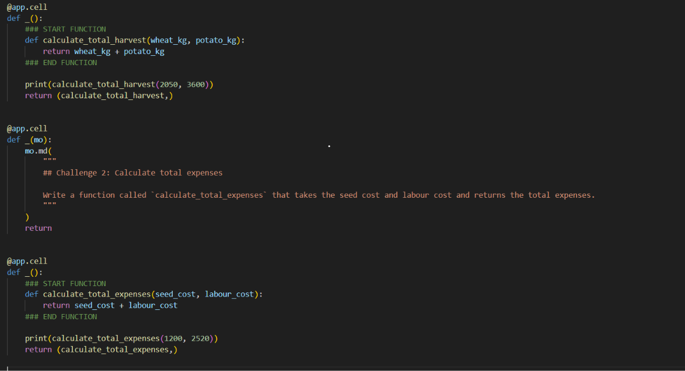
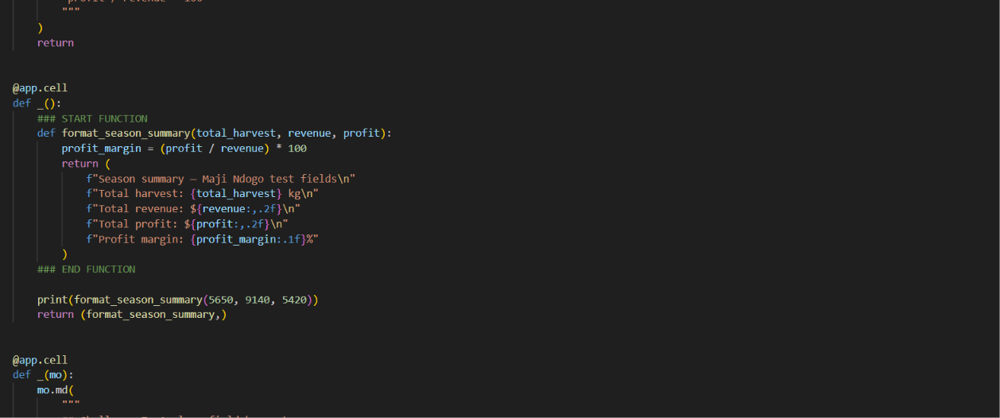
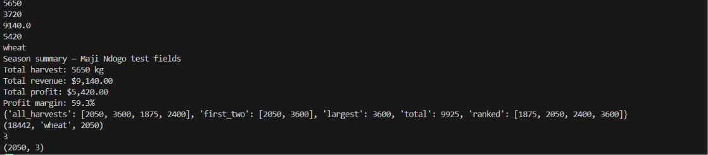
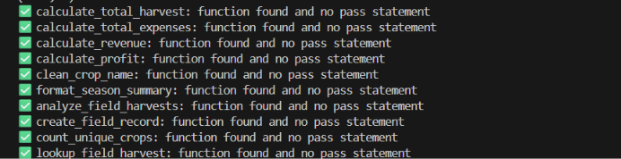

# Maji Ndogo: Farm Harvest Management

## 1. The Business Problem

The Maji Ndogo project explores how Python programming can support agricultural management and decision-making. Managing farm harvests involves keeping track of crop yields, expenses, revenue, and profit. Performing these calculations manually can take time and may lead to errors.

The goal of my Farm Harvest Management project was to develop reusable Python functions that simplify these tasks. The functions help organize harvest information, process crop names, manage field records, and calculate important financial measures. This project demonstrates how programming can make agricultural data easier to manage and interpret.

## 2. The Tech Stack

- **Python:** Used to develop, run, and test functions for agricultural data processing and calculations.
- **Visual Studio Code (VS Code):** Used as the development environment for writing and testing Python code.

## 3. The Deliverable

The main deliverable was a collection of 10 Python functions developed and tested to support farm harvest management.

The functions covered:

- Calculating total harvest quantities.
- Calculating total farm expenses.
- Calculating revenue and profit.
- Cleaning crop names for consistent data entry.
- Analyzing harvest records using lists.
- Creating field records.
- Counting unique crop types.
- Retrieving harvest information for a specific field.

I tested the functions with sample inputs to check that they returned the expected results. For example, the calculations returned a total harvest of 5,650 kg, total expenses of 3,720, revenue of 9,140, and profit of 5,420 for the sample values used in testing.

The project focused on Python functions and their outputs; it did not include charts or visualizations.

### Project Screenshots

The following screenshots show selected Python functions, their outputs, and the final readiness check.

**1. Harvest Calculations**

**2. Season Summary**

**3. Field Harvest Records**

**4. Final Readiness Check**

## 4. The So What?

This project strengthened my ability to use Python to solve practical problems through reusable functions, data cleaning, calculations, and testing. It showed me how simple automation can reduce repetitive work and help organize agricultural information.

The project also helped me understand how harvest, expense, revenue, and profit data can support better farm management decisions. As a Statistics student developing my data analytics skills, I gained practical experience translating a business problem into a structured programming solution.

My next step is to build on these foundations by working with larger datasets, performing exploratory data analysis, and communicating findings through appropriate visualizations and reports.
